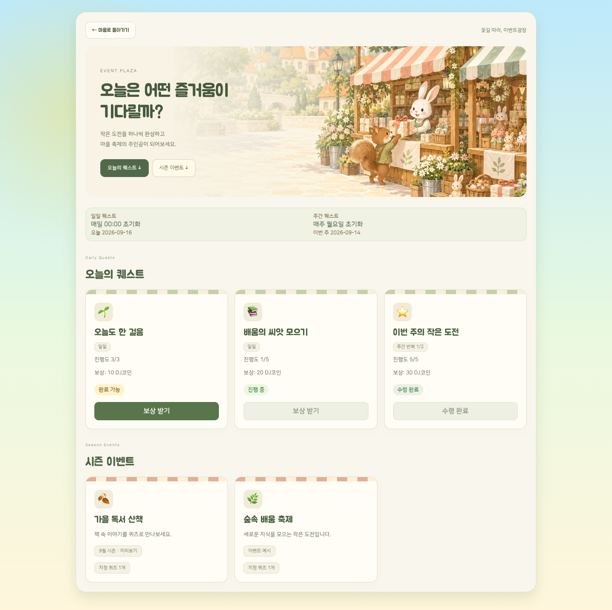
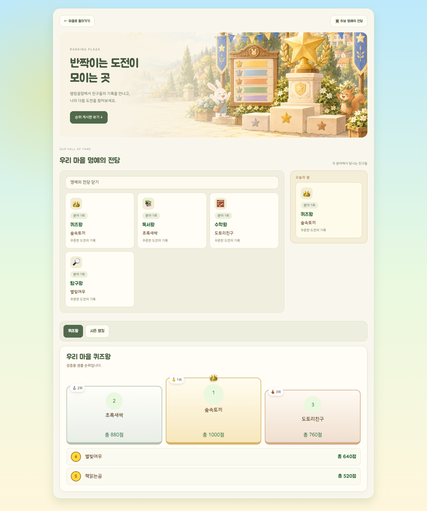

# 이벤트광장 · 랭킹광장 그림책 UI

상점 자체 아바타·하우징 프로토타입은 유지하고 두 광장의 진입 화면을 수정했다. 로컬 변경이며 배포하지 않았다.

- 이벤트광장: 축제 부스 그림, 퀘스트·시즌 바로가기, 줄무늬 차양 카드, 진행도와 보상 상태.
- 랭킹광장: 별 트로피와 순위 게시판 그림, 명예의 전당·오늘의 왕·순위 탭 구성.
- 기존 랭킹 렌더러, 시즌 구분, 보상 클릭 처리와 데이터 경로를 유지했다. 빈 이벤트에는 안내 문구를 표시한다.
- 스타일은 `public/plaza-views.css`에서 두 화면에 한정한다. 운영 데이터·보안 규칙은 변경하지 않았다.

## 이미지

OpenAI imagegen 도구로 각각 새 원본 일러스트를 생성했다. 글씨와 버튼은 HTML로 분리했다. 정확한 생성 프롬프트와 자산 경로는 [프롬프트 기록](PLAZA_STORYBOOK_IMAGE_PROMPTS_2026-09-16.json)에 있다.

## 검증

- `npm run check:static` 통과.
- 이벤트·랭킹 application 테스트 통과.
- `node scripts/smoke/plaza-storybook-browser.js` 통과: 실제 렌더러에 샘플 데이터를 넣어 랭킹 탭·하위 탭, 명예의 전당 펼치기, 보상 버튼 호출 및 비활성 상태, 빈 시즌 안내를 확인.
- 데스크톱 1440px, 모바일 390px 화면 가로 넘침 없음. 이미지 로딩과 스타일 적용 확인.
- 운영 Firebase 연결 없이 검사했다. 캡처의 이름·점수·이벤트는 샘플이다.

## 화면

[이벤트 모바일](plaza-review/event-plaza-mobile.png) · [랭킹 모바일](plaza-review/ranking-plaza-mobile.png)
